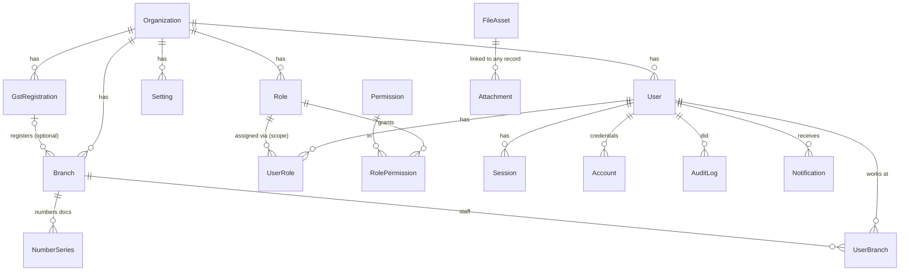
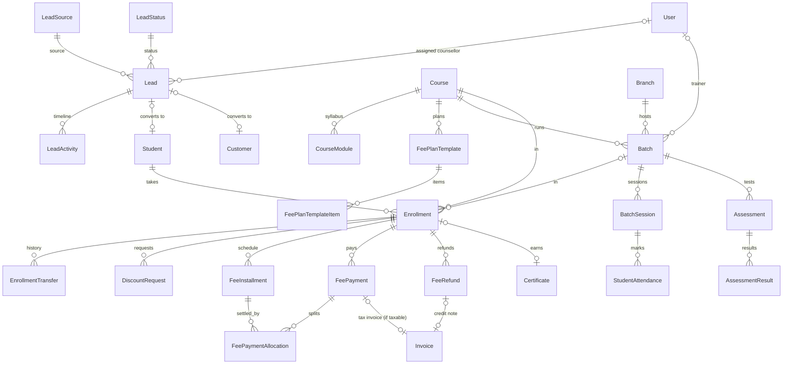
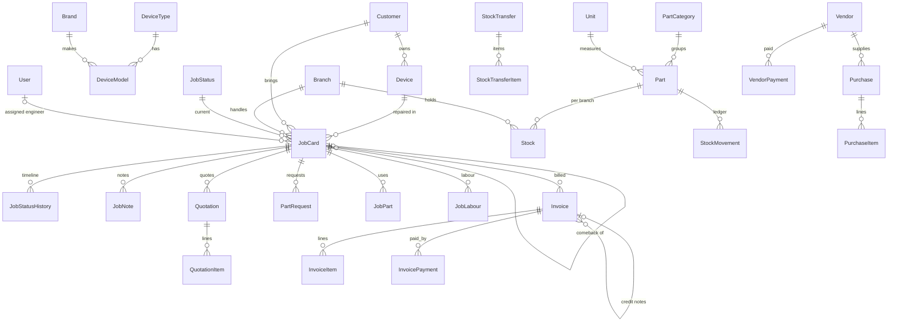
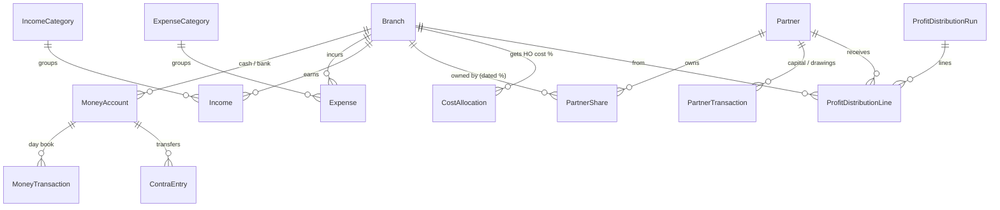
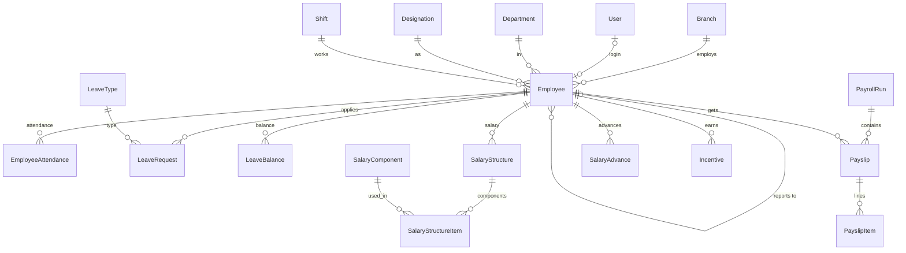
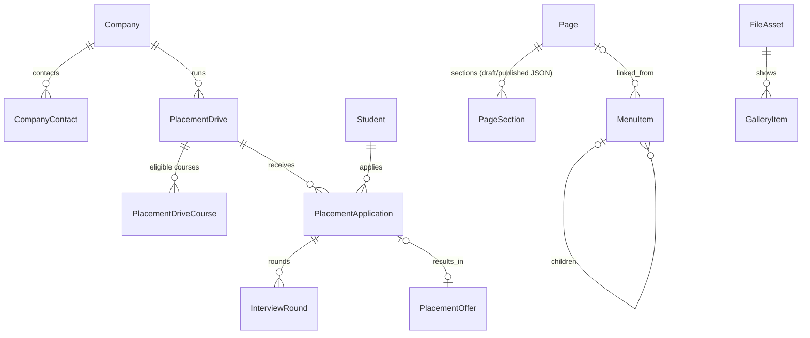

# Phase 0 – Design

Status: **approved 2026-11-17**. Phase 1 has been built on this design.
Full schema: [`prisma/schema.prisma`](../prisma/schema.prisma) (126 models, 50 enums; it passes `prisma validate` on Prisma 7.10.1).

---

## 1. Business rules confirmed in Phase 0

| Topic            | Decision                                                                                   | How the design handles it                                                                                                                                     |
| ---------------- | ------------------------------------------------------------------------------------------ | ------------------------------------------------------------------------------------------------------------------------------------------------------------- |
| Ownership        | **Different owners and share % per branch**                                                | `PartnerShare(partner, branch, %, effectiveFrom, effectiveTo)`. For each branch and date, shares must total 100%. Profit is split branch by branch.           |
| Shared costs     | **Allocated by a fixed % per branch**                                                      | A `HEAD_OFFICE` branch holds shared expenses. `CostAllocation(branch, %, dated)` splits them across the operating branches before owner profit is calculated. |
| Course pricing   | **One fixed fee per course**                                                               | `Course.fee`. Modules are syllabus content only. Instalment plans come from `FeePlanTemplate`.                                                                |
| GST on courses   | **Set per course**                                                                         | `Course.gstMode` = EXEMPT / INCLUSIVE / EXCLUSIVE, plus a tax rate and SAC code. The values are copied onto the `Enrollment` at admission.                    |
| GST registration | **Some branches are unregistered**                                                         | `GstRegistration` table. `Branch.gstRegistrationId` is optional, and a branch without one issues **Non-GST invoices**.                                        |
| Numbering        | **Per branch, resets every financial year (1 April)**                                      | `NumberSeries(branch, docType, financialYear, nextNumber, format)`, incremented atomically in the same DB transaction as the document.                        |
| Counter sales    | **None.** Parts leave stock only through job cards, transfers, adjustments or internal use | There is no POS/sales module. `Invoice` is linked to a job card or an enrollment.                                                                             |
| Discounts        | **Need approval above a per-role limit.** Limit 0 = every discount needs approval          | `Role.discountLimitPercent` / `discountLimitAmount` + `DiscountRequest`. A request within the limit is auto-approved and still logged.                        |
| Refunds          | **Allowed**, with approval                                                                 | `FeeRefund` (approval flow). If the original payment had a tax invoice, a **credit note** is issued.                                                          |
| Stock costing    | **Weighted average cost**                                                                  | `Stock.qty` + `Stock.avgCost` per branch. `StockMovement` is a ledger that is only ever added to. Job parts record the average cost at issue time for COGS.   |
| Payroll          | **Simple**: fixed salary, loss of pay, manual allowances/deductions, advances, incentives  | `SalaryStructure` → `PayrollRun` → `Payslip`. No PF/ESI/PT/TDS.                                                                                               |

---

## 2. Key technical decisions

- **Next.js 16 (App Router) + TypeScript strict**, a single app with route groups for the public site, auth and admin.
- **Prisma 7 (stable 7.10.x)**, not the 8.0 RC. Uses the new `prisma-client` generator, and the DB URL goes in `prisma.config.ts`.
- **Better Auth** (credentials, DB sessions, built-in rate limiting). I chose it over Auth.js because Auth.js credentials login doesn't support database sessions well, and we need to revoke sessions when a user is deactivated.
- **Money** is `Decimal(12,2)` and computed with `Prisma.Decimal`. JS floats are never used for money. GST is rounded per line and the invoice total is rounded to the rupee (`roundOff` field).
- **Dates**: `@db.Date` for business dates. Times are stored as UTC and shown in IST as DD/MM/YYYY. The financial year helper turns `2026-11-17` into `"26-27"`.
- **SaaS-ready**: every main table has `organizationId`. Only the core tables (Branch, User, Role, Setting, GstRegistration) have an FK to Organization, and the others keep a plain column. There are no multi-tenant features.
- **Soft delete**: `deletedAt`, filtered out by a Prisma client extension. Restore is supported. Ledgers (stock movements, money transactions, audit log) are never deleted.
- **Snapshots**: invoices copy the seller and customer details, and enrollments copy the fee and GST. Later master-data edits never change issued documents.
- **People**: `User` = a login. `Employee` = the HR record (optional 1:1 link to User). `Partner` = a co-owner (optional link to User). The trainer, engineer and counsellor fields point to **User**, because the "own records" scope is checked against the logged-in user.

### RBAC rules

- A user has one or more `UserRole`s, and each has a **scope**: `OWN`, `ASSIGNED_BRANCHES` or `ALL_BRANCHES`.
- Effective permission = the union across the user's roles. For each permission, the **widest scope** from any role that grants it applies.
- `OWN` = records the user is responsible for (assigned engineer on job cards, trainer on batches, assignee on leads, own leave/payslips), within their assigned branches.
- Every server action goes through one wrapper: `authenticate → check permission → build branch/scope filter → validate with Zod → call service → write audit log`.
- To restrict an owner, give them a custom role. There are no per-user permission overrides, to keep it simple.

### GST / invoice logic (see open points 1 to 3)

```
branch has no GSTIN               → NON_GST_INVOICE  (no tax lines)
branch has GSTIN, course EXEMPT   → BILL_OF_SUPPLY
branch has GSTIN, taxable line    → TAX_INVOICE
   seller state == place of supply → CGST + SGST (rate / 2 each)
   otherwise                       → IGST
INCLUSIVE price: taxable = price × 100 / (100 + rate)
```

Service invoices carry their own HSN/SAC and rate on each line (parts usually HSN at 18%, labour SAC 9987 at 18%). These rates are master data, not hard-coded.

### Branch P&L and owner profit

```
Revenue      = issued service invoices (taxable value, after credit notes)
             + fee income (taxable value of fee receipts, after refunds)
             + other income
Direct costs = approved expenses of the branch
             + COGS: parts issued to jobs at avg cost (after returns) + internal use
             + payroll (gross after LOP + incentives) of the branch's employees
Allocated    = head-office expenses + head-office payroll × branch allocation %
Net profit   = Revenue − Direct − Allocated
Owner share  = Net profit × owner % for that branch
```

Purchases go into stock, not expenses. A **ProfitDistributionRun** saves and locks the numbers for a period. If shares change during the period, the run splits the period at that date. The combined P&L is the sum of the branches, and head office always comes to zero because its costs are fully allocated.

### Warranty and repeat repairs

On delivery, `warrantyUntil` = delivery date + days from the most specific `WarrantyRule`. When a new job is created for a device whose IMEI or serial matches a job still under warranty, the user gets a "possible comeback" prompt. Linking it sets `parentJobId` and `isWarrantyJob`, and the engineer report counts it as a comeback.

---

## 3. Folder structure

```
.
├─ CLAUDE.md                     conventions, commands, decisions (kept updated)
├─ README.md
├─ docker-compose.yml            Postgres 17 (+ Mailpit for dev email)
├─ .env.example
├─ prisma.config.ts
├─ prisma/
│  ├─ schema.prisma
│  ├─ migrations/
│  └─ seed/                      index.ts + data/*.ts (realistic demo data)
├─ docs/
│  ├─ PHASE_0_DESIGN.md
│  └─ BACKUP.md                  backup & restore plan (Phase 1)
├─ public/
├─ tests/e2e/                    Playwright (login, intake→invoice, admission→fee)
└─ src/
   ├─ app/
   │  ├─ (public)/               website: layout, page.tsx (home), about, courses/[slug], ...
   │  ├─ (auth)/login/
   │  ├─ admin/                  admin panel: layout (sidebar, topbar), dashboard, modules...
   │  ├─ api/
   │  │  ├─ auth/[...all]/       Better Auth handler
   │  │  ├─ files/[id]/          signed/private file access
   │  │  ├─ pdf/[doc]/[id]/      invoice, receipt, job card, certificate, payslip
   │  │  └─ cron/[job]/          due reminders, low-stock alerts (secured by secret)
   │  ├─ sitemap.ts
   │  └─ robots.ts
   ├─ modules/                   one folder per domain, business logic lives here
   │  ├─ <domain>/
   │  │  ├─ <domain>.service.ts  business rules (no UI, testable with Vitest)
   │  │  ├─ <domain>.actions.ts  server actions: the authz wrapper + Zod, then the service
   │  │  ├─ <domain>.queries.ts  read/list queries for pages and tables
   │  │  ├─ <domain>.schemas.ts  Zod schemas (shared by forms and actions)
   │  │  ├─ components/          domain UI (forms, tables, dialogs)
   │  │  └─ <domain>.test.ts
   │  └─ auth, rbac, branches, audit, settings, numbering, tax, files, notifications,
   │     crm, courses, students, fees, service, inventory, purchases, invoices,
   │     accounts, partners, hr, payroll, placements, cms, reports, search, imports
   ├─ components/
   │  ├─ ui/                     shadcn/ui
   │  ├─ data-table/             TanStack Table wrapper (search, filters, sort, paging, export)
   │  ├─ forms/                  RHF field components (phone, money, DD/MM/YYYY date)
   │  ├─ layout/                 admin sidebar, topbar, branch switcher, breadcrumbs, theme toggle
   │  └─ site/                   public header/footer, section renderers, GSAP animations
   ├─ lib/
   │  ├─ db.ts                   Prisma client + soft-delete extension
   │  ├─ auth.ts                 Better Auth config
   │  ├─ permissions.ts          permission catalogue (source of truth, seeded)
   │  ├─ authz.ts                requirePermission(), scopeWhere(), action wrapper
   │  ├─ money.ts  dates.ts  phone.ts  fy.ts
   │  ├─ storage/                local | s3 driver behind one interface
   │  ├─ notify/                 email now; sms/whatsapp providers later
   │  ├─ pdf/                    React-PDF templates
   │  └─ env.ts                  Zod-validated env
   ├─ styles/globals.css         design tokens (CSS variables, light/dark)
   └─ generated/prisma/          (gitignored)
```

---

## 4. ERD (Mermaid)

Split by domain to keep each diagram readable. Field details are in the schema.

### 4.1 Core, RBAC, audit



### 4.2 CRM, students, fees



### 4.3 Service centre, invoices, inventory



### 4.4 Accounts, owners



### 4.5 HR, payroll



### 4.6 Placements, website CMS



Other CMS tables: `ServiceOffering`, `Testimonial`, `SuccessStory`, `Faq`, `Banner`. Site-wide values (contact, socials, WhatsApp, SEO defaults, footer) live in `Setting`.

---

## 5. Permissions

The format is `module.action`. The catalogue lives in `src/lib/permissions.ts` and is synced to the DB by the seed script. The admin builds roles from these in the permission matrix.

| Module               | Actions                                                                                                          |
| -------------------- | ---------------------------------------------------------------------------------------------------------------- |
| `dashboard`          | view                                                                                                             |
| `branches`           | view, create, update, delete                                                                                     |
| `users`              | view, create, update, delete, reset_password                                                                     |
| `roles`              | view, manage                                                                                                     |
| `audit`              | view                                                                                                             |
| `settings`           | view, update (company, GST, number series, templates, message templates)                                         |
| `masters`            | general, crm, students, service, inventory, accounts, hr (each grants managing that group of master data)        |
| `leads`              | view, create, update, delete, assign, convert, export                                                            |
| `courses`            | view, manage                                                                                                     |
| `batches`            | view, create, update, delete                                                                                     |
| `students`           | view, create, update, delete, transfer, import, export                                                           |
| `student_attendance` | view, mark                                                                                                       |
| `assessments`        | view, manage, enter_marks                                                                                        |
| `certificates`       | view, issue, revoke                                                                                              |
| `fees`               | view, collect, cancel_receipt, discount_request, discount_approve, refund_request, refund_approve, waive, export |
| `jobcards`           | view, create, update, assign, change_status, qc, deliver, cancel, delete, export                                 |
| `quotations`         | create, record_decision                                                                                          |
| `part_requests`      | create, issue                                                                                                    |
| `invoices`           | view, create, cancel, credit_note, collect_payment, export                                                       |
| `inventory`          | view, adjust, transfer, receive_transfer, export                                                                 |
| `parts`              | manage, import                                                                                                   |
| `purchases`          | view, create, post, cancel                                                                                       |
| `vendors`            | view, manage, pay                                                                                                |
| `employees`          | view, create, update, delete, view_sensitive, import                                                             |
| `hr_attendance`      | view, mark                                                                                                       |
| `leaves`             | apply, approve                                                                                                   |
| `payroll`            | view, run, finalize, mark_paid                                                                                   |
| `incentives`         | manage, approve                                                                                                  |
| `advances`           | manage                                                                                                           |
| `accounts`           | view_daybook, manage_accounts, contra                                                                            |
| `income`             | view, create                                                                                                     |
| `expenses`           | view, create, approve, pay                                                                                       |
| `partners`           | view, manage                                                                                                     |
| `profit`             | view, run, lock, manage_allocation                                                                               |
| `companies`          | view, manage                                                                                                     |
| `placements`         | view, manage_drives, manage_applications                                                                         |
| `website`            | view, edit, publish                                                                                              |
| `media`              | manage                                                                                                           |
| `reports`            | view, financial, export                                                                                          |

### Default role mapping (seeded, editable)

| Role                      | Default scope              | Permissions                                                                                                    |
| ------------------------- | -------------------------- | -------------------------------------------------------------------------------------------------------------- |
| Owner / Partner           | All branches               | everything                                                                                                     |
| Admin                     | All branches               | everything except `profit.lock` and `partners.manage`                                                          |
| Branch Manager            | Assigned branches          | all operational modules + approvals (discount, refund, leave, expense), reports. No roles, partners or profit  |
| Accountant                | Assigned branches          | fees._, invoices._, income._, expenses._, accounts.*, payroll.view/mark_paid, vendors.pay, reports.financial   |
| HR                        | Assigned branches          | employees._, hr_attendance._, leaves._, payroll._, incentives._, advances._, masters.hr                        |
| Counsellor / Front Office | Assigned branches          | leads.*, students.create/view, fees.collect/discount_request, jobcards.create/view, quotations.record_decision |
| Trainer                   | Own                        | batches.view, student_attendance.*, assessments.enter_marks                                                    |
| Placement Officer         | Assigned branches          | companies._, placements._, students.view                                                                       |
| Service Manager           | Assigned branches          | jobcards._, quotations._, invoices.create/collect_payment, part_requests.*, inventory.view                     |
| Service Engineer          | Own                        | jobcards.view/update/change_status, part_requests.create, quotations.create                                    |
| Store Keeper              | Assigned branches          | inventory._, parts._, purchases.*, vendors.view, part_requests.issue                                           |
| Student / Customer        | Own (portals, later phase) | portal-only permissions added in Phase 8                                                                       |

Discount limits are seeded per role, for example Counsellor 0%, Branch Manager 10%, Owner/Admin unlimited. They can be edited in the role screen.

---

## 6. Page map

### Public website (`(public)`, SSG/ISR, revalidated when content is published)

| Route                                           | Content                                      |
| ----------------------------------------------- | -------------------------------------------- |
| `/`                                             | GSAP home (sections from the CMS)            |
| `/about`                                        |                                              |
| `/courses`, `/courses/[slug]`                   | from `Course` (where `showOnWebsite` is set) |
| `/services`, `/services/[slug]`                 | from `ServiceOffering`                       |
| `/branches`                                     | branch cards + map links                     |
| `/placements`                                   | stats + success stories + company logos      |
| `/gallery`, `/testimonials`, `/faq`, `/contact` |                                              |
| `/enquire`                                      | course enquiry form, creates a `Lead`        |
| `/book-repair`                                  | service booking form, creates a `Lead`       |
| `/track`                                        | repair status (job no. + phone)              |
| `/verify`, `/verify/[code]`                     | certificate verification (the QR target)     |
| `/[...slug]`                                    | custom CMS pages                             |
| `/sitemap.xml`, `/robots.txt`                   |                                              |

### Auth

`/login`, `/forgot-password`, `/reset-password`

### Admin (`/admin`, sidebar grouped by module, only permitted items shown)

| Group      | Pages                                                                                                                                                                                                                                                                                                                                         |
| ---------- | --------------------------------------------------------------------------------------------------------------------------------------------------------------------------------------------------------------------------------------------------------------------------------------------------------------------------------------------- |
| Dashboard  | `/admin` (role-based widgets)                                                                                                                                                                                                                                                                                                                 |
| CRM        | `/admin/leads`, `/admin/leads/[id]`, `/admin/leads/follow-ups`                                                                                                                                                                                                                                                                                |
| Students   | `/admin/students`, `/admin/students/new` (admission), `/admin/students/[id]` (profile, enrollments, fees, attendance, results, timeline), `/admin/courses`, `/admin/courses/[id]`, `/admin/batches`, `/admin/batches/[id]` (roster, attendance, assessments), `/admin/certificates`                                                           |
| Fees       | `/admin/fees/collect`, `/admin/fees/payments`, `/admin/fees/dues`, `/admin/fees/discounts` (approvals), `/admin/fees/refunds`                                                                                                                                                                                                                 |
| Service    | `/admin/service/intake`, `/admin/service/jobs`, `/admin/service/jobs/[id]` (timeline, quote, parts, labour, invoice, QC, delivery), `/admin/service/board` (kanban by status), `/admin/service/customers`, `/admin/service/customers/[id]`                                                                                                    |
| Invoices   | `/admin/invoices`, `/admin/invoices/[id]`, `/admin/invoices/credit-notes`                                                                                                                                                                                                                                                                     |
| Inventory  | `/admin/inventory/stock`, `/admin/inventory/parts`, `/admin/inventory/movements`, `/admin/inventory/transfers`, `/admin/inventory/requests`, `/admin/purchases`, `/admin/purchases/[id]`, `/admin/vendors`                                                                                                                                    |
| HR         | `/admin/employees`, `/admin/employees/[id]`, `/admin/hr/attendance`, `/admin/hr/leaves`, `/admin/hr/holidays`, `/admin/payroll`, `/admin/payroll/[runId]`, `/admin/hr/incentives`, `/admin/hr/advances`                                                                                                                                       |
| Accounts   | `/admin/accounts/daybook`, `/admin/accounts/income`, `/admin/accounts/expenses`, `/admin/accounts/money-accounts`, `/admin/accounts/pnl` (branch + combined), `/admin/accounts/partners`, `/admin/accounts/partners/[id]` (shares, capital, drawings), `/admin/accounts/profit-distribution`                                                  |
| Placements | `/admin/placements/companies`, `/admin/placements/drives`, `/admin/placements/drives/[id]`, `/admin/placements/stats`                                                                                                                                                                                                                         |
| Website    | `/admin/website/pages`, `/admin/website/pages/[id]` (section editor + preview), `/admin/website/menu`, `/admin/website/media`, `/admin/website/services`, `/admin/website/testimonials`, `/admin/website/stories`, `/admin/website/gallery`, `/admin/website/faqs`, `/admin/website/banners`, `/admin/website/seo`                            |
| Reports    | `/admin/reports` (+ one page per report, date/branch filters, Excel/PDF)                                                                                                                                                                                                                                                                      |
| Settings   | `/admin/settings/company`, `/admin/settings/gst`, `/admin/settings/branches`, `/admin/settings/number-series`, `/admin/settings/templates` (PDF), `/admin/settings/messages`, `/admin/settings/masters/[group]`, `/admin/settings/users`, `/admin/settings/roles` (permission matrix), `/admin/settings/audit-log`, `/admin/settings/imports` |
| (top bar)  | branch switcher, global search, notifications, theme toggle, profile                                                                                                                                                                                                                                                                          |

### Portals (Phase 8)

`/portal/student/*` (fees, attendance, results, certificates, jobs) and `/portal/customer/*` (track, approve quote, invoices).

---

## 7. Home page (GSAP) proposal

All text, images and numbers come from the CMS. GSAP is only loaded on `/`, and everything uses `useGSAP` + `gsap.matchMedia()`.

1. **Hero**: staggered headline reveal. An SVG circuit board whose traces "draw in" (stroke-dashoffset), with a chip that tilts slightly toward the pointer (`gsap.quickTo`, pointer devices only). Two CTAs: _Enquire about a course_ and _Book a repair_.
2. **Stats band**: counters for students trained, devices repaired, branches and placement %, triggered once by ScrollTrigger.
3. **What we do**: two large cards (Institute / Service centre) with a soft reveal and hover tilt.
4. **How a repair works**: a pinned horizontal-scroll story (Received → Diagnosis → Repair → QC → Delivered) on desktop. Mobile gets a simple vertical stepper.
5. **Featured courses**: card grid with a stagger reveal.
6. **Placements**: company logo marquee (CSS, pauses on hover) + success story cards.
7. **Testimonials**: a light carousel (Embla), auto-advance off when reduced motion is on.
8. **Branches**: cards with pulsing pins on an SVG map and Google Maps links. No heavy map JS on load.
9. **CTA band** + WhatsApp button.

Performance: SVG only (no WebGL or video in the hero), `next/image` with lazy loading, **no smooth-scroll library**, and with `prefers-reduced-motion` all motion becomes simple fades. Target Lighthouse ≥ 90 on mobile.

---

## 8. Open points (they don't block the schema, but please confirm)

1. **GST invoice number length.** GST rules limit invoice numbers to **16 characters**. `KOC/INV/26-27/00042` is 19, so it's too long. Proposal: job cards `KOC/JC/26-27/00042` (no limit), Tax Invoice `KOC/2627/00042`, Bill of Supply `KOC/B2627/00042`, Credit Note `KOC/C2627/00042` (branch codes are limited to 4 characters so these always fit). The settings screen will warn if a GST document format can exceed 16 characters.
2. **Taxable course fees**: I plan to issue **one tax invoice per payment received**, since GST applies when an advance is received for services. Please confirm with your CA.
3. **Place of supply**: I'll assume it is the branch's state, so CGST+SGST. IGST is used only when a B2B customer with a GSTIN from another state is billed. Please confirm with your CA.
4. **When revenue counts in the P&L**: proposal is fees on the **receipt date** and service on the **invoice date**.
5. **Warranty comebacks**: should a valid warranty comeback be free for labour only, or for labour and parts? (The engineer can always override.)
6. **Seed data**: how many owners and branches, with city names, so the demo data looks like your setup? I'll use 3 owners, 3 branches + head office otherwise.
7. **Device passwords/pattern locks**: I've deliberately **not** stored them. If your technicians need them, I'll add an encrypted field that only the assigned engineer can see.

---

## 9. Phase 1 scope (after approval)

Project setup (Next 16, TS strict, ESLint, Prettier, Vitest, Playwright), Docker Compose (Postgres + Mailpit), Prisma 7 + first migration, Better Auth login with rate limiting, users, branches, roles + permission matrix, branch switcher, audit log, design tokens + light/dark/system theme, admin layout (sidebar, breadcrumbs, top bar), settings (company, GST registrations, number series), the seed script, CLAUDE.md, README, BACKUP.md.
